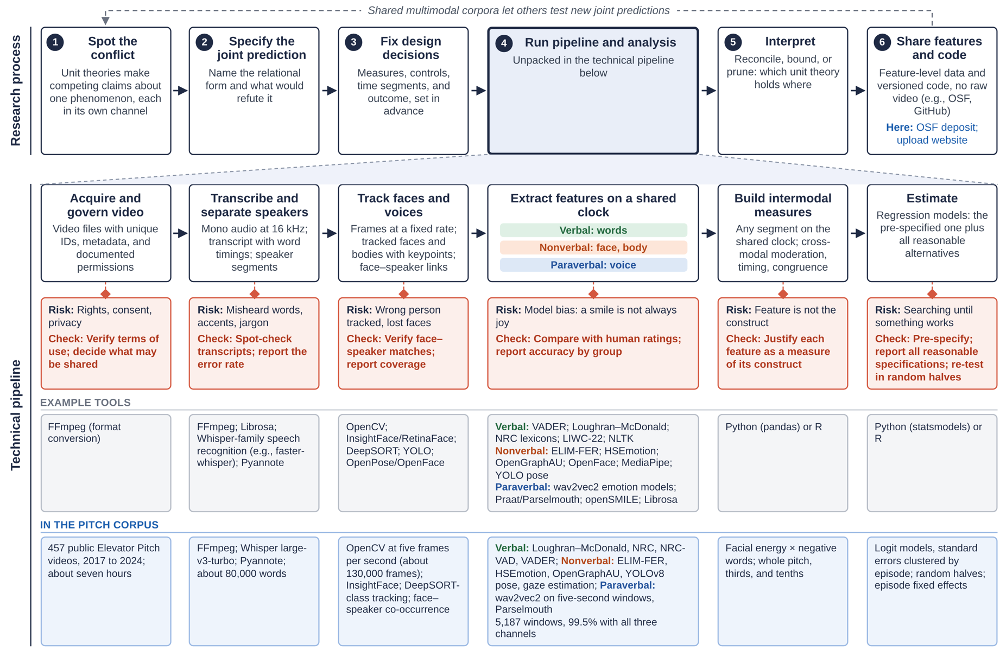
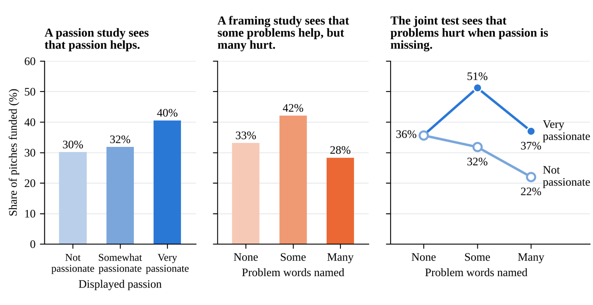
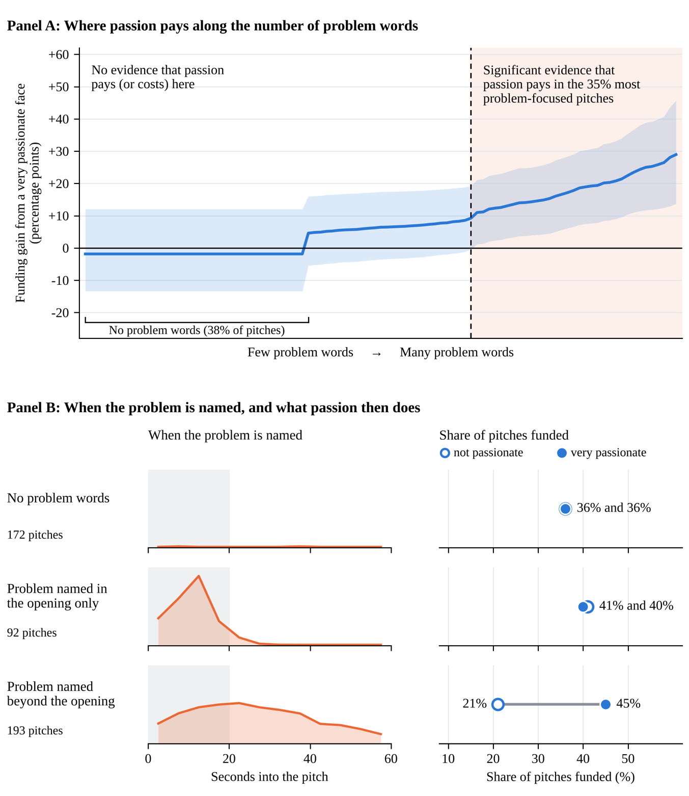
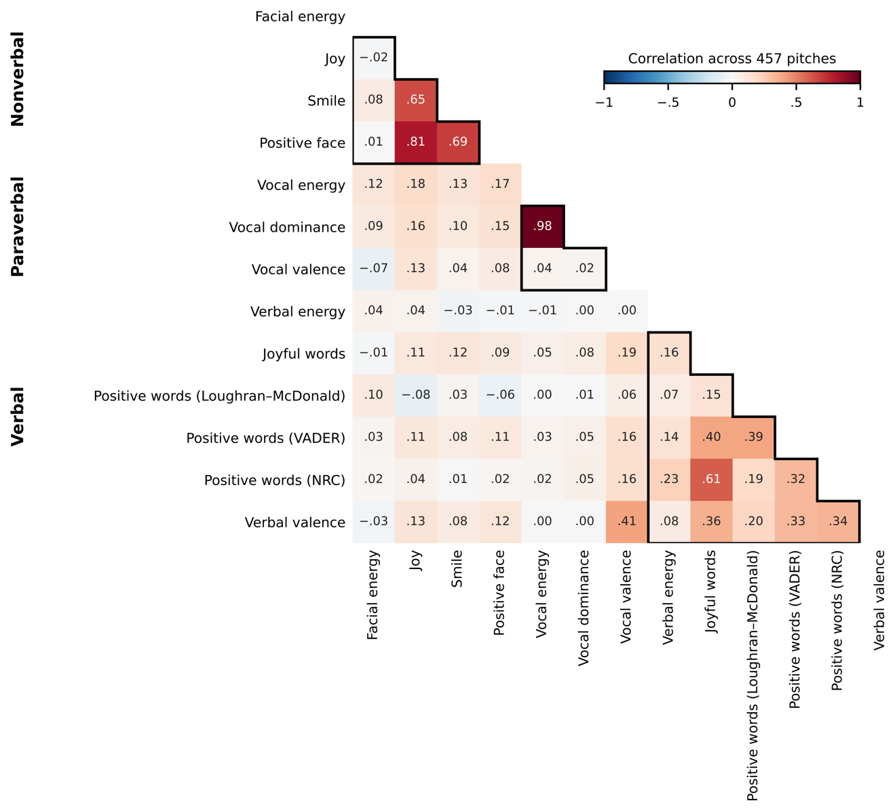

# More than words

Replication package for the manuscript *More than words: Testing programmatic theory with AI-based multimodal video analysis.*

Authors withheld for blind review.

One command reproduces the tables and figures from `data/pitches.csv`. Pitch videos are not included.

Run the commands from the folder that contains this file.

## Run

```bash
python -m venv .venv
.venv\Scripts\activate          # Windows
# source .venv/bin/activate      # macOS or Linux
pip install -r requirements.txt
python run_all.py
```

`python run_all.py --quick` uses fewer repetitions and skips the checks that depend on them. A full run takes a few minutes and writes `output/results.md`, `output/results.json`, and `output/figures/`. The `output/` folder already in this package is that reference run. Running the script replaces it.

Use statsmodels 0.15 or newer. Version 0.14 drops a few small-sample fits, which moves two of the subset shares in Table 3, Panel C, by one point.

## What the check compares

`run_all.py` compares each printed number with the manuscript and compares the unrounded coefficients with `reference/manuscript_tables.json`. The main result is facial energy × Loughran–McDonald negative words: b = 0.31 (SE 0.10), p = .002 (Table 2, Model 3). Negative words in that model are the Loughran–McDonald list alone. VADER and the three-dictionary average appear only as robustness rows.

The included run matches 74 of 74 reported numbers. The full list is in `output/results.md`.

## Data

| File | What it is |
|---|---|
| `data/pitches.csv` | 457 pitches. Outcomes, controls, and the measures the models use. `run_all.py` reads this file. |
| `data/transcripts.csv` | Transcript of each pitch. `run_all.py` reads this file for the examples. |
| `data/presenter.csv` | Presenter id for each pitch. Two columns only. |
| `data/inputs/mediaflow/per_frame/body_frames.parquet` | Frame-level face measures. Used only by `prep/build_face_measures.py`. Stored with Git LFS because of its size. |
| `data/inputs/mediaflow/per_frame/voice_asr.csv` | Timestamped transcript segments. Used only by `verbal/build_verbal_features.py`. |

`python prep/build_face_measures.py` rebuilds joy, smile, and positive face from the frame table and checks them against `data/pitches.csv`. That file comes through Git LFS, so install Git LFS and run `git lfs pull` before this check. `python run_all.py` does not need it.

The NRC word list is not included. The NRC scores used in the robustness rows are already in `data/pitches.csv`. The Loughran–McDonald counts in that file were computed from the 2018 master dictionary; the dictionary itself is not included. Download pages for both lists are in `verbal/lexicons/README.md`.

## Optional: rebuild word features

`python run_all.py` does not need this. `verbal/build_verbal_features.py` rebuilds word features from the transcript segments. It needs spaCy (`en_core_web_sm`), vaderSentiment, and empath, which are not in `requirements.txt`. Loughran–McDonald and the NRC lists are not in the package; put your own copies in `verbal/lexicons/` (see `verbal/lexicons/README.md`). A missing list is skipped.

```bash
python verbal/build_verbal_features.py --replication . --lexicons verbal/lexicons --out verbal/out
```

## What lines up with the manuscript

| Manuscript | This package |
|---|---|
| Table 2, the joint test | `code/step1_reconciliation.py` |
| Table 3, where the effect holds | `code/step2_boundary.py` |
| Table 4, which measures overlap | `code/step3_pruning.py` |
| Table 5, robustness | `code/step5_robustness.py` |
| Table 6, what the joint term adds | `code/step4_ladder.py` |
| Figure 2 | `figures/figure2.png` |
| Figure 3 | `figures/figure3.png` |
| Figure 4 | `figures/figure4.png` |
| Figure 5 | `figures/figure5.png` |

The files in `figures/` are the images from the manuscript. Figure 1 is a drawing format this page cannot display. `python run_all.py` also writes its own graphs to `output/figures/`. Those are not the manuscript images.

## Manuscript figures









## Layout

`code/` holds the six steps. `run_all.py` runs them in order. `reference/` holds the unrounded coefficients behind the manuscript tables. `LICENSE` is the MIT license; the copyright line names no person.
